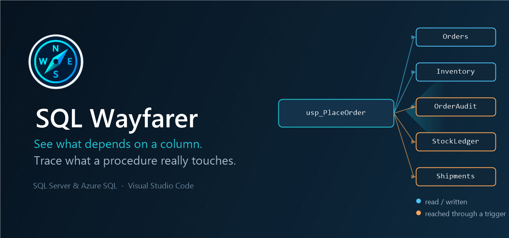
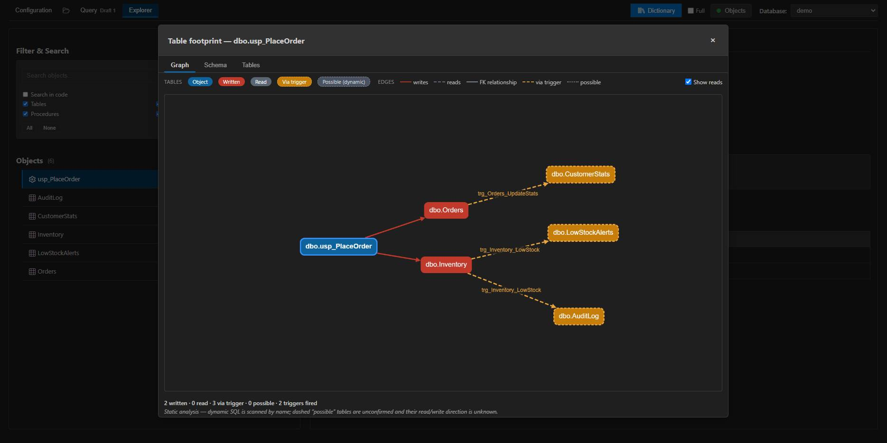

# SQL Wayfarer

**See exactly what a SQL Server change will break — down to the column — directly inside VS Code.**

It is built for the day you inherit a legacy SQL Server database — no documentation, no tests, triggers nobody remembers — and have to change it without breaking anything.

> **Early Access** — Core features are stable and actively developed. Feedback and bug reports are welcome via [GitHub Issues](https://github.com/intarynx/sqlwayfarer/issues).

---

## Overview

Every change to a database raises the same question: what else does this touch? SQL Wayfarer answers it by tracing column-level lineage and dependency chains through views, procedures, functions and triggers — including the trigger cascades a procedure fires that you'd never see by reading its code — so you know the real impact before you make a change, not after.

Around that: a full SQL Server and Azure SQL workspace inside VS Code — schema browsing, a multi-buffer query editor, script generation, and Markdown documentation export, without leaving your editor.

*`usp_PlaceOrder` only mentions `Orders` and `Inventory`. The Table Footprint graph follows the triggers it fires and shows the other three tables it actually touches.*

---

## Features

### Column-Level Lineage
*"What breaks if I rename this column?"*
- Every view, procedure, function, and trigger definition is parsed (Babelfish T-SQL grammar) during indexing to record which columns of which tables it reads or writes
- The Structure tab shows a **Used by** badge per column: how many objects reference it, which ones write to it (✍), and which matches are ambiguous (`~`)
- Click the badge to list the referencing objects and jump to any of them in the Explorer
- Alias resolution, CTE exclusion, MERGE targets, and trigger `inserted`/`deleted` pseudo-tables are handled

### Table Footprint
*"Which tables does this procedure really touch — including through triggers?"*
- A **Table Footprint** button on any procedure, function, or view opens an interactive graph of every table it reads and writes
- Follows nested procedure/function/view calls **and the DML trigger cascades** that fire when a table is written — surfacing tables a procedure touches indirectly that you would never see by reading its code
- Tables are colour-coded by access: **written**, **read**, reached **only via a trigger**, or a low-confidence **possible** match found by scanning dynamic-SQL text for known object names
- Three tabs: **Graph** (the object-centric footprint with a "Show reads" toggle), **Schema** (a pure relational ER of the tables with their PK/FK columns), and **Tables** (lean per-table columns, keys, and descriptions — analyze in place without exporting the dictionary)
- The Graph tab reports how many triggers fired and how many references stayed unresolved, and flags when the analysis hit its depth limit — so you know how far the footprint actually reached

### Dependency Analysis
- Visualize which objects depend on a given object and which objects it depends on, as a tree or as a graph
- See the actual operation performed on each dependency (SELECT, INSERT, UPDATE, DELETE, MERGE), extracted by parsing the object's T-SQL definition — aliased targets (`UPDATE t … FROM Task t`) are resolved to the real table
- Understand the full impact of a change before making it

### Local Schema Index
*How the analysis above stays fast on a large database*
- Schema, dependency, and column-lineage metadata are indexed locally per connection (keyed by server + database, surviving VS Code restarts), so browsing, dependency, and lineage lookups stay fast after the first scan
- **Incremental refresh**: when the schema changes, only added or modified objects are re-analyzed; a full rebuild only happens on first indexing or Force Reindex
- Real progress reporting (8 objects analyzed concurrently per step), cancellable mid-index

### Query Tool
*Every open buffer lives in one dropdown under the Query tab — no editor-tab clutter, however many scripts you have open*
- **Multiple buffers per tab**: pick from a dropdown under "Query" showing every open buffer — a draft, or a `.sql` file on disk you can save straight back to (`Ctrl+S` or the Save button) — without ever spawning a native VS Code editor tab. Each buffer remembers which database it was last run against, restored automatically when you switch back to it.
- **Workspace SQL file browser**: a collapsible side panel (folder icon next to the Query tab) lists every `.sql` file in the workspace, including subfolders, with a filter box and per-folder collapse.
- **Crash recovery**: unsaved drafts and in-progress edits to an open file are snapshotted continuously and restored automatically if VS Code closes unexpectedly — nothing saved to disk is ever auto-modified, only the in-editor buffer is recovered.
- Run free-form T-SQL against the selected database, with multiple result sets, a configurable row cap (up to **Unlimited**), and cancellation of long-running queries
- **Result grid filtering and sorting**: filter rows by any text, click a column header to sort — resets on every new run
- **Messages tab**: `PRINT` / `RAISERROR` output collects in its own tab, interleaved in the order it actually happened relative to each result set, instead of attaching to whichever grid happened to be active
- **Execution plans**: Estimated Plan and Actual Plan buttons render the query plan inline, with dark-mode support
- **Query graph**: a button in the Query toolbar graphs what the editor's query touches — the tables it reads, the join conditions between them, and the tables reached through the procedures, functions and views it calls
- The joins come from a real T-SQL parser, so the edges are the ones the query actually writes: `ON` conditions with their columns, `LEFT`/`INNER`/`CROSS` kinds, comma joins (flagged as inferred), and CTEs or derived tables resolved to the tables behind them
- **Select a query in the editor and the graph covers that query only**; with no selection, the whole buffer is graphed
- Three tabs, as in the Table Footprint: **Graph** (the join graph), **Schema** (the PK/FK relations between those tables), and **Tables** (their columns, keys and descriptions)
- **SQL Snippets**: a quick-insert dropdown (built-in templates plus your own custom snippets, managed from the Configuration tab)
- **Schema-aware autocompletion**: object names, schema-prefixed lookups, and alias-resolved column suggestions (`FROM Employee e` → `e.` lists Employee's columns)
- **Go to definition**: `Ctrl+Click` (`Cmd+Click` on macOS) or double-click an object name — aliases and cross-database references included — to jump to it in the Explorer
- **Destructive statement guardrails**: `UPDATE`/`DELETE` without a `WHERE` clause (detected by a real T-SQL parser, so batches and subqueries are analyzed correctly), `TRUNCATE TABLE`, and `DROP` require explicit confirmation before running
- **Copy / CSV export** on every result set: tab-separated copy that pastes straight into Excel, and CSV export with RFC 4180 escaping and a UTF-8 BOM so accents survive Excel
- Persistent query history with deduplication

### Schema Explorer
- Browse databases, schemas, tables, views, stored procedures, and functions
- Filterable object list organized by schema and type, with live match counts per schema
- **Search in code**: find every view, procedure, or function whose definition mentions a given text ("where is this column used?")
- **Table statistics at a glance**: each table shows a badge with its row count and reserved size (e.g. `1.2M · 340 MB`), loaded from allocation metadata in a single query — instant even on very large databases
- **▶ Top 10** button on tables and views to peek at data instantly
- Native `Ctrl+F` search across object lists, code, and query results

### Object Inspector
| Tab | What you see |
|-----|-------------|
| **Structure** | Columns (with per-column usage — see Column Lineage), data types, primary keys, foreign keys, indexes, row count and disk usage breakdown (data / indexes / reserved), and — for procedures and functions — a ready-to-use call snippet |
| **Tree** | A three-level dependency tree for the selected object |
| **Graph** | Rendered dependency graph showing what depends on the object and what it depends on |
| **Code** | The object's T-SQL definition with line metrics and one-click copy |
| **Comments** | Editable extended properties and inline documentation |

- **Cross-database dependencies**: a dependency that lives in another database (a view of this one selecting from `OtherDb.dbo.Orders`) is listed with its real type — resolved in the database that owns it, not guessed from the local index — and is a link: one click opens that database in the Explorer and selects the object. Cross-database nodes are dashed in the dependency graph.

### Script Generator
A 📜 button on every object in the Explorer generates ready-to-edit scripts straight into the Query tab (without running them):
- **Tables**: `SELECT` with all columns, `INSERT`/`UPDATE` templates with typed placeholders and a primary-key `WHERE`, and full `CREATE TABLE` DDL (identity, computed columns, defaults, primary key, secondary indexes, foreign keys with cascade rules)
- **Views**: `SELECT` with all columns, plus the full `CREATE` definition
- **Procedures**: `EXEC` template with typed parameters (adds a result `SELECT` when the procedure declares `OUTPUT` parameters), plus the full `CREATE` definition
- **Functions**: call template for scalar and table-valued functions, plus the full `CREATE` definition

### Documentation
- Read and write MS_Description extended properties directly from the panel
- **Data dictionary export**: generate a complete Markdown data dictionary of the database — every table, view, procedure, and function with columns, keys, parameters, cross-linked dependencies, and your extended-property descriptions
- **Full mode** (a checkbox next to the Dictionary button): additionally documents, per table, indexes, incoming foreign-key relations, CHECK/UNIQUE constraints, and triggers, plus a compact per-table Mermaid ER diagram, a whole-database model summary, User Defined Types, and row counts and size. Full mode exports a **folder of linked files** (a `README.md` index plus one file per page of objects) instead of a single document, so large schemas never produce one file too big for a Markdown viewer to render

### Connection Management
- Save and switch between multiple SQL Server connections
- Secure credential storage integrated with VS Code
- Connection testing with live feedback
- SQL login, or a Windows account typed as `DOMAIN\user` in the username field
- **Microsoft Entra ID** (Azure SQL): pick *Microsoft Entra ID* as the authentication of a connection. It signs in with the Microsoft account of VS Code (MFA and single sign-on included), stores no password, and renews the token in the background. The connection is always encrypted
- **Authentication limits**: a Windows account (`DOMAIN\user`) is sent to the server with its password (NTLM), saved once in VS Code's secret storage. **Integrated authentication** (the current Windows session, SSPI/Kerberos) is not supported: the underlying driver, tedious, is pure JavaScript and cannot call SSPI
- **Auto-connect**: the last connection used is reconnected automatically when the panel opens (toggleable, and the last connection stays pre-selected either way)

## Getting Started

1. Install [**SQL Wayfarer**](https://marketplace.visualstudio.com/items?itemName=intarynx.sqlwayfarer) from the VS Code Marketplace.
2. Click the compass icon in the Activity Bar to open the panel.
3. Add a connection using your SQL Server credentials.
4. Select a database and start exploring.

You can also open the panel via `Ctrl+Shift+P` → **Open SQL Wayfarer**.

---

## Requirements

| Requirement | Minimum version |
|-------------|----------------|
| VS Code | 1.100+ |
| SQL Server | 2017+ (table details rely on `STRING_AGG`) |
| Azure SQL | Any tier |
| Permissions | `db_datareader` for browsing; `VIEW DEFINITION` on target objects for the Code tab, dependency analysis, and column lineage; `VIEW DATABASE STATE` for table size/row-count badges (optional — the Explorer simply shows no badges without it); `ALTER` on the target objects to read/write extended properties (Comments) |

---

## Known Limitations

- Encrypted object definitions cannot be retrieved by design (SQL Server restriction).
- Very large databases may experience slower initial indexing (each code object is parsed once for dependencies and column lineage; subsequent refreshes are incremental).
- T-SQL syntax highlighting covers standard cases; complex dialect features may not be fully highlighted.
- Dependency operations and column lineage are detected via static analysis of T-SQL: dynamic SQL (`EXEC` of a string), calls through another procedure, or references used only as a parameter type are shown without a specific operation. The Table Footprint additionally scans module text for qualified names of known objects to catch tables referenced only inside dynamic SQL, but marks them as low-confidence "possible" (read/write direction unknown).
- Column lineage favors recall over precision: an unqualified column in a multi-table statement is attributed to every table in scope and flagged as ambiguous (`~`) rather than dropped.

---

## Contributing

Bug reports and feature requests are tracked on [GitHub Issues](https://github.com/intarynx/sqlwayfarer/issues). Pull requests are welcome.

---

*SQL Wayfarer — built for developers who spend their days navigating complex databases.*
