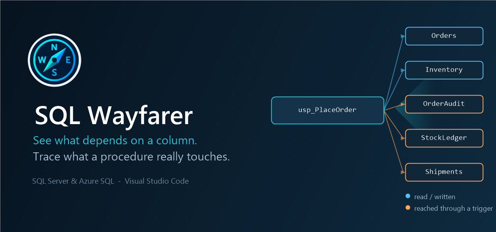
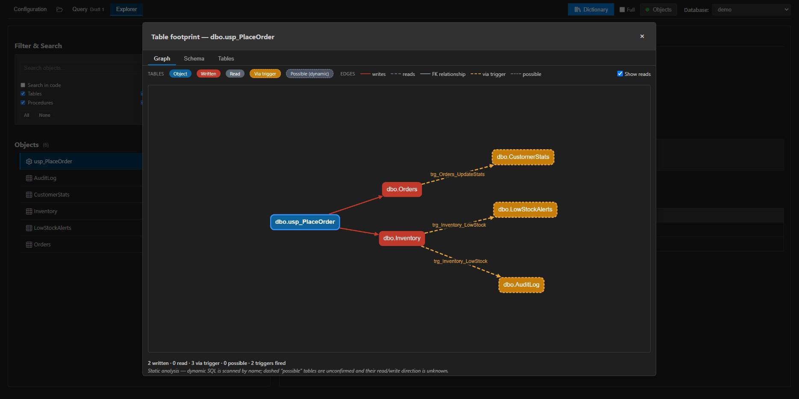

# SQL Wayfarer

**See exactly what a SQL Server change will break — down to the column — directly inside VS Code.**

It is built for the day you inherit a legacy SQL Server database — no documentation, no tests, triggers nobody remembers — and have to change it without breaking anything.

> **Early Access** — Core features are stable and actively developed. Feedback and bug reports are welcome via [GitHub Issues](https://github.com/intarynx/sqlwayfarer/issues).

---

## Why this exists

Most of the time you do not get to design the database you work on. You inherit it: hundreds of tables, procedures that call procedures, triggers nobody remembers writing, a column whose name made sense to someone who left years ago. Before every change you have to answer the same questions — *what reads this column? what writes to this table? what fires when I delete a row?* — and reading code to answer them does not scale.

SQL Wayfarer was built by a developer who maintains exactly that kind of database, to answer those questions inside VS Code, without a second tool and without guessing. Everything in it serves one goal: **let you change a complicated database without being afraid of it.**

It is deliberately not a deployment tool, a schema-compare tool or a data editor. It is for understanding, tracing, documenting and querying a SQL Server or Azure SQL database.

## Free, with no strings attached

- **Free, and it stays free.** There is no paid tier, no "pro" edition, no account, no licence key and no upsell — now or later. It is not a commercial product and is not meant to become one. Tools with comparable query-editor features (Redgate SQL Prompt, for example) are paid; this one is a gift to the people who have to live in databases like these.
- **Open source, MIT.** You can read every line of what runs against your server, and fork it.
- **No telemetry.** Nothing is collected and nothing is sent anywhere. Details in [Privacy](#privacy).

## Can you trust it?

A tool that tells you "this is safe to change" has to earn that. Here is what it does, and what it does not claim.

- **It reads; it does not write behind your back.** Browsing, inspection, indexing, the footprint, the query graph and the data dictionary only read. The only things that write are the queries you run yourself (destructive ones — `UPDATE`/`DELETE` without `WHERE`, `TRUNCATE`, `DROP` — ask for confirmation first) and the Comments tab, which saves `MS_Description` extended properties when you save them. Scripts it generates are placed in the editor, never run.
- **It starts from what SQL Server itself reports.** Dependencies come from the server's own metadata (`sys.dm_sql_referenced_entities`); a real T-SQL parser then adds what the metadata cannot say: which columns, and which operations. On the AdventureWorks sample database, the dependencies it finds match the server's own, 154 out of 154.
- **It says when it does not know.** Dynamic SQL, a reference it cannot resolve, a definition it could not parse cleanly: each one is flagged as *possible*, *ambiguous* or *partial* instead of making the result look complete.
- **It does not start heavy work on its own.** The dependency index is only built when you ask for it, with a notice that explains what it costs. When the schema changes, the Explorer lists *which* objects an update would re-analyze, and waits for you.
- **It is tested.** The parser, the autocompletion (more than a hundred scenarios: CTEs, temp tables, table variables, table-valued functions, `MERGE`...), the pages in a headless browser, and a suite that runs against a real SQL Server.
- **What is not proven yet.** It is young. Validation on very large, tangled production schemas is ongoing, Microsoft Entra ID sign-in is beta, and integrated Windows authentication has seen limited testing. If it gets something wrong on your database, that is the most useful bug report there is.

---

## Overview

Every change to a database raises the same question: what else does this touch? SQL Wayfarer answers it by tracing column-level lineage and dependency chains through views, procedures, functions and triggers — including the trigger cascades a procedure fires that you'd never see by reading its code — so you know the real impact before you make a change, not after.

Around that: a full SQL Server and Azure SQL workspace inside VS Code — schema browsing, a multi-buffer query editor, script generation, and Markdown documentation export, without leaving your editor.

*`usp_PlaceOrder` only mentions `Orders` and `Inventory`. The Table Footprint graph follows the triggers it fires and shows the other three tables it actually touches.*

---

## Features

### Column-Level Lineage
*"What breaks if I rename this column?"*
- Every view, procedure, function, and trigger definition is parsed (Babelfish T-SQL grammar) during indexing to record which columns of which tables it reads or writes
- The Structure tab shows a **Used by** badge per column: how many objects reference it, which ones write to it (✍), and which matches are ambiguous (`~`)
- Click the badge to list the referencing objects and jump to any of them in the Explorer
- Alias resolution, CTE exclusion, MERGE targets, and trigger `inserted`/`deleted` pseudo-tables are handled

### Table Footprint
*"Which tables does this procedure really touch — including through triggers?"*
- A **Table Footprint** button on any procedure, function, or view opens an interactive graph of every table it reads and writes
- Follows nested procedure/function/view calls **and the DML trigger cascades** that fire when a table is written — surfacing tables a procedure touches indirectly that you would never see by reading its code
- Every write counts, including the ones that name no column: a `DELETE` and an `INSERT` without a column list are detected as writes, so the triggers of a deleted table are followed too
- A table mentioned without its schema is resolved the way SQL Server resolves it inside a module — against the schema of the module that mentions it
- Tables are colour-coded by access: **written**, **read**, reached **only via a trigger**, or a low-confidence **possible** match found by scanning dynamic-SQL text for known object names
- Three tabs: **Graph** (the object-centric footprint with a "Show reads" toggle), **Schema** (a pure relational ER of the tables with their PK/FK columns), and **Tables** (lean per-table columns, keys, and descriptions — analyze in place without exporting the dictionary)
- The Graph tab reports how many triggers fired and how many references stayed unresolved, and flags when the analysis hit its depth limit — so you know how far the footprint actually reached
- A definition that could not be parsed cleanly is flagged: the analysis is partial, and the view says so instead of looking complete

### Dependency Analysis
- Visualize which objects depend on a given object and which objects it depends on, as a tree or as a graph
- See the actual operation performed on each dependency (SELECT, INSERT, UPDATE, DELETE, MERGE), extracted by parsing the object's T-SQL definition — aliased targets (`UPDATE t … FROM Task t`) are resolved to the real table
- Understand the full impact of a change before making it

### Local Schema Index
*How the analysis above stays fast on a large database*
- **You decide when to index**: nothing is analyzed on its own. The Explorer shows a notice explaining what the index is and what building it costs, with **Build index** / **Not now**; a schema that changed since is offered as **Update index**. Without an index, the object list, structure, code, comments, search and the Query tab work as usual; only the dependency Tree/Graph, column usage, write footprint and query graph need it
- Schema, dependency, and column-lineage metadata are indexed locally per connection (keyed by server + database, surviving VS Code restarts), so browsing, dependency, and lineage lookups stay fast after the first scan
- **Incremental refresh**: when the schema changes, only added or modified objects are re-analyzed; a full rebuild only happens on the first build you ask for or on Force Reindex
- Real progress reporting (8 objects analyzed concurrently per step), cancellable mid-index

### Query Tool
*Every open buffer lives in one dropdown under the Query tab — no editor-tab clutter, however many scripts you have open*
- **Multiple buffers per tab**: pick from a dropdown under "Query" showing every open buffer — a draft, or a `.sql` file on disk you can save straight back to (`Ctrl+S` or the Save button) — without ever spawning a native VS Code editor tab. Each buffer remembers which database it was last run against, restored automatically when you switch back to it. The chevron next to "Query" opens that list and shows how many buffers are open; `Ctrl+Alt+PageDown` / `Ctrl+Alt+PageUp` go to the next / previous one.
- **The color of the editor's focus frame tells the state of the query**: purple for a draft that is not in a file, orange for a file with unsaved changes, the theme's focus color for a file saved as it is on disk
- **Workspace SQL file browser**: a collapsible side panel (folder icon next to the Query tab) lists every `.sql` file in the workspace, including subfolders, with a filter box and per-folder collapse.
- **Instance tree**: the *Instance* tab of the same side panel lists the databases of the connection the tab runs on, then their tables, views, procedures and functions (read level by level, when a database is opened). Right click, or the menu key, on an object: *Show details*, *Script as* (SELECT, INSERT, UPDATE, CREATE, EXEC, written into the editor with a `USE` when it is another database), *Rename…*, *Delete…* (also `F2` and `Delete`), *Copy name*. Rename and Delete show the exact SQL and the objects of the database that refer to it before anything runs, and run on the tab's own session, so an open transaction applies to them. The refresh button of the panel reloads the instance; the tree always follows the connection the queries run on, never a schema read from another connection
- **Crash recovery**: unsaved drafts and in-progress edits to an open file are snapshotted continuously and restored automatically if VS Code closes unexpectedly — nothing saved to disk is ever auto-modified, only the in-editor buffer is recovered.
- Run free-form T-SQL against the selected database, with multiple result sets, a configurable row cap (up to **Unlimited**), and cancellation of long-running queries
- **Result grid filtering and sorting**: filter rows by any text, click a column header to sort — resets on every new run
- **Errors point to their line**: `Line 12` in an error message is a link that puts the cursor on that line of the editor
- **Messages tab**: `PRINT` / `RAISERROR` output collects in its own tab, interleaved in the order it actually happened relative to each result set, instead of attaching to whichever grid happened to be active
- **Execution plans**: Estimated Plan and Actual Plan buttons render the query plan inline, with dark-mode support
- **Syntax check** (off by default, `sqlwayfarer.diagnostics.syntax`): SQL Server itself parses the editor's text after a pause in typing (`SET PARSEONLY ON`, on a connection of its own) and the errors are underlined on their line, with the server's message on hover. Nothing is run and names are not checked, so a table that does not exist is not an error; a script with sqlcmd variables is left alone, and so is a batch that mentions `PARSEONLY`.
- **Open transactions**: a panel runs every script on one connection of its own, like a query window of SSMS, so a `BEGIN TRAN` stays open until it is ended. While one is, the footer of the results shows **Transaction open** with **Commit** and **Roll back**; nothing is shown otherwise. Closing the panel with a transaction still open asks what to do, and rolls it back if the question is dismissed. The Explorer and the other tabs use other connections and never run inside it. A `#temp` table now also survives from one run to the next
- **Query graph**: a button in the Query toolbar graphs what the editor's query touches — the tables it reads, the join conditions between them, and the tables reached through the procedures, functions and views it calls
- The joins come from a real T-SQL parser, so the edges are the ones the query actually writes: `ON` conditions with their columns, `LEFT`/`INNER`/`CROSS` kinds, comma joins (flagged as inferred), and CTEs or derived tables resolved to the tables behind them
- **Select a query in the editor and the graph covers that query only**; with no selection, the whole buffer is graphed
- Three tabs, as in the Table Footprint: **Graph** (the join graph), **Schema** (the PK/FK relations between those tables), and **Tables** (their columns, keys and descriptions)
- **SQL Snippets**: a quick-insert dropdown (built-in templates plus your own custom snippets, managed from the *Snippets* tab of the SQL Wayfarer sidebar)
- **Context-aware autocompletion**: suggestions follow the clause you are in (tables after `FROM`/`JOIN`, columns in `SELECT`/`WHERE`/`ON`, procedures after `EXEC`, parameters after `EXEC proc`). Columns are offered without a prefix, from the tables of the current statement only (aliases, subqueries, CTEs, derived tables, temp tables and table variables included). After `JOIN`, the tables related by foreign key come first with their `ON` condition. Matching is fuzzy (`ho` → `HumanOrders`), `Ctrl+Space` after `*` expands it to the column list, a details line shows type, nullability and keys, data types are offered where a type is expected (`DECLARE`, `CAST`, `CREATE TABLE`, procedure parameters), `ORDER BY` offers the aliases of the select list, a `JOIN` without a foreign key proposes the key columns the two tables share, table-valued functions expose their columns, and abbreviations such as `ssf` expand to snippets. Everything is configurable under `sqlwayfarer.autocomplete.*` (trigger, matching, keyword case, accept keys, aliases, brackets, system objects...)
- **Go to definition**: `Ctrl+Click` (`Cmd+Click` on macOS) or double-click an object name — aliases and cross-database references included — to jump to it in the Explorer
- **Destructive statement guardrails**: `UPDATE`/`DELETE` without a `WHERE` clause or with an always-true one (detected by a real T-SQL parser, so batches and subqueries are analyzed correctly), `TRUNCATE TABLE`, `DROP` of any object, `ALTER TABLE … DROP COLUMN` / `ALTER COLUMN`, `MERGE … THEN DELETE`, `ALTER DATABASE … SET SINGLE_USER/OFFLINE/EMERGENCY` and `xp_cmdshell` require explicit confirmation before running. A statement written as a literal inside `EXEC('…')` or `sp_executesql` is checked too; SQL built in a variable and a procedure that deletes by its own logic are not. Temporary tables and table variables are left alone
- **Production connections**: tick *Production connection* when you edit a saved connection. Its list entry gets a `PROD` badge, its tab a `PRODUCTION` banner, and every statement that changes data or schema (`INSERT`, `UPDATE`, `DELETE`, `MERGE`, `CREATE`, `ALTER`, `DROP`, `TRUNCATE`) asks for a confirmation, whatever its `WHERE`
- **Copy / CSV export** on every result set: tab-separated copy that pastes straight into Excel, and CSV export with RFC 4180 escaping and a UTF-8 BOM so accents survive Excel (JSON too, see below)
- **Run** (`F5` / `Ctrl+Enter`): the selected text when there is some, the whole editor otherwise, as SSMS does; an error's line number is the one of the editor in both cases
- **Format SQL** (`Shift+Alt+F`, or the toolbar button): the selection, or the whole script; `GO` lines are kept and each batch is formatted on its own. A script that cannot be parsed is left untouched
- **Find and replace** in the editor with `Ctrl+H`
- **Large results**: the grid draws 2 000 rows at a time with **Show more** / **Show all**; Copy and the exports always include every row. Double-click a cell to copy it
- **Export** every result set as CSV or JSON
- **Snippets from SQL Prompt**: the *Snippets* tab of the sidebar imports `.sqlpromptsnippet` files, one by one or a whole folder (subfolders included), after showing what was found and which ones already exist (keep them or overwrite). The shortcut becomes the snippet's **abbreviation**: type it in the editor and it is offered. `$Placeholder$` fields (with their default values) are filled in by pressing `Tab` from one to the next, `$CURSOR$` is where the caret ends up, `$SELECTEDTEXT$` is replaced by the text that was selected. Your own snippets can have an abbreviation and use `$CURSOR$` / `$SELECTEDTEXT$` too. Only the files you pick are read
- Persistent query history with deduplication

### Schema Explorer
- Browse databases, schemas, tables, views, stored procedures, and functions
- Filterable object list organized by schema and type, with live match counts per schema
- **Search in code**: find every view, procedure, or function whose definition mentions a given text ("where is this column used?")
- **Table statistics at a glance**: each table shows a badge with its row count and reserved size (e.g. `1.2M · 340 MB`), loaded from allocation metadata in a single query — instant even on very large databases
- **Top 10** button on tables and views to peek at data instantly
- **Keyboard and context menu**: the object list is one tab stop; arrow keys move through schemas and objects (`←`/`→` fold a schema, `Home`/`End`, typing a letter jumps to a name), `Enter` opens the details, and right click or `Shift+F10` (the menu key) opens a menu: details, top 10 rows, scripts, copy name
- Native `Ctrl+F` search across object lists, code, and query results

### Object Inspector
| Tab | What you see |
|-----|-------------|
| **Structure** | Columns (with per-column usage — see Column Lineage), data types, primary keys, foreign keys, indexes, row count and disk usage breakdown (data / indexes / reserved), and — for procedures and functions — a ready-to-use call snippet |
| **Tree** | A three-level dependency tree for the selected object |
| **Graph** | Rendered dependency graph showing what depends on the object and what it depends on |
| **Code** | The object's T-SQL definition with line metrics and one-click copy |
| **Comments** | Editable extended properties and inline documentation |

- **Cross-database dependencies**: a dependency that lives in another database (a view of this one selecting from `OtherDb.dbo.Orders`) is listed with its real type — resolved in the database that owns it, not guessed from the local index — and is a link: one click opens that database in the Explorer and selects the object. Cross-database nodes are dashed in the dependency graph.

### Script Generator
A 📜 button on every object in the Explorer generates ready-to-edit scripts straight into the Query tab (without running them):
- **Tables**: `SELECT` with all columns, `INSERT`/`UPDATE` templates with typed placeholders and a primary-key `WHERE`, and full `CREATE TABLE` DDL (identity, computed columns, defaults, primary key, secondary indexes, foreign keys with cascade rules)
- **Views**: `SELECT` with all columns, plus the full `CREATE` definition
- **Procedures**: `EXEC` template with typed parameters (adds a result `SELECT` when the procedure declares `OUTPUT` parameters), plus the full `CREATE` definition
- **Functions**: call template for scalar and table-valued functions, plus the full `CREATE` definition

### Compare
A **Compare** tab shows what changed in the database the queries run on since a reference, and writes the script that repeats the change on another database.
- **The reference is a SQL Server database snapshot** (a read-only copy as of the moment it was taken) or any other database of the instance. *Take snapshot…* shows the exact `CREATE DATABASE … AS SNAPSHOT OF` and the cost (it grows as the database changes; the database cannot be dropped or restored while it exists) before anything is run; *Drop* removes it. Nothing is ever taken automatically. Not available on Azure SQL Database, on a system database, or with FILESTREAM / memory-optimized data; before SQL Server 2016 SP1 it needs the Enterprise, Developer or Evaluation edition.
- **The comparison reads both catalogs in one round trip** (about 2 s for 700 tables and 2 100 procedures, views, functions and triggers). It covers schemas, tables (columns, identity, computed columns, defaults, collations, primary key, unique constraints, indexes with INCLUDE and filter, foreign keys, check constraints), views, procedures, functions and triggers. Constraints the server named itself are compared by what they do, not by their name; a definition is compared without line ends, trailing blanks, or whether it says CREATE or ALTER. What is not read (synonyms, sequences, user types, CLR, columnstore/XML indexes, partitioning…) is counted and said, never reported as identical; temporal, memory-optimized, graph and file tables are left out altogether, since a `CREATE TABLE` written from the catalog would not rebuild them. Column properties such as sparse, masked or encrypted, and permissions, are not compared either, and a column of a user-defined type needs the type to exist on the target (the script warns).
- **Git-style view**: the changes by kind, each added (+), modified (~) or removed (−), with a risk (*caution*: can fail on the data that is there; *destructive*: loses data; *manual*: cannot be done in place), the operations of a table one per line, and a line diff for code. Each change can be unchecked.
- **The script is re-entrant**, written to be run on databases whose state nobody is sure of: every step tests the state it changes (never a version number), so a second run changes nothing, a run on a database that is already ahead does no harm, and a run on one that was half updated finishes the job. One statement per batch, ordered (what blocks first, then columns, keys, indexes, checks, foreign keys, code), and **it stops at the first error**; fix it and run the script again from the top. Destructive steps are left out, and named in the script, unless *Include destructive changes* is checked. Before SQL Server 2016 SP1 the code is written with a stand-in and `ALTER` instead of `CREATE OR ALTER`. The script opens in a new query to be read, or can be applied from the tab (below).
- **Apply…** runs the script on a database of this connection or of another saved connection (the database the changes come from is not offered). The target is read first and put against the changes: *to do* (still as in the reference), *already as in the current database*, and *partly done or different* (the script finishes what is half done and overwrites what is different), with the number of steps, what is left out and the warnings. Nothing runs before a confirmation naming the server and the database; the script is written for the **target's** SQL Server version. It runs batch by batch with a progress bar and can be stopped between batches; afterwards the target is read again and what still differs on the picked changes is listed (the steps that were left out are among them). A script that stopped on an error is applied again from the top once the cause is fixed.

- **Modified since…** (second view of the tab) lists what was created or altered in the database in the last 15 minutes to 30 days, **without a snapshot**: it reads the dates the server keeps on its objects (`sys.objects`), newest first, each marked *new* (created, not altered since) or *altered*, with how long ago and, for views, procedures, functions and triggers, their code. It sees tables (a change to their structure, indexes or constraints moves their date), constraints, views, procedures, functions, triggers, synonyms and sequences. It **does not see what was dropped, nor what happened to the data**: a snapshot shows what was dropped. The ages come from the server's own clock, so the time zone of the machine does not matter.

### Documentation
- Read and write MS_Description extended properties directly from the panel
- **Data dictionary export**: generate a complete Markdown data dictionary of the database — every table, view, procedure, and function with columns, keys, parameters, cross-linked dependencies, and your extended-property descriptions
- **With details** (a checkbox next to the Dictionary button): additionally documents, per table, indexes, incoming foreign-key relations, CHECK/UNIQUE constraints, and triggers, plus a compact per-table Mermaid ER diagram, a whole-database model summary, User Defined Types, and row counts and size. This mode exports a **folder of linked files** (a `README.md` index plus one file per page of objects) instead of a single document, so large schemas never produce one file too big for a Markdown viewer to render

### Connection Management
- Save and manage your connections from the **SQL Wayfarer sidebar** (activity bar): create, edit, delete and test them there. Each connection opens in its own SQL Wayfarer tab (click it in the list, or use the *Open SQL Wayfarer* command); a connection that is already open is shown instead of opened twice, and a dot marks the open ones. The sidebar has a *Connections* and a *Snippets* tab with the same layout: a filter box and a + on top, then the list (sorted; the filter searches name, server or database, and Enter opens the first match), and an inline form with a back arrow. A server + login has one tab: opening another saved connection of the same server (say, another database) shows that tab and moves it to the database of the connection you picked; a connection saved with a database opens on it
- **Import your servers** from a **Central Management Server** (it reads the registered servers and their groups from `msdb`; the `ServerGroupReaderRole` role is enough) or from a **registered servers file** (`.regsrvr`, exported by SSMS). A checklist shows what was found, and what is already saved starts unchecked. Connections keep their **group** (an optional field of the connection, shown as folding headers in the list). No password is ever imported: like SSMS, a CMS server is reached with Windows authentication, and a `.regsrvr` entry keeps the way of signing in its connection string describes.
- Secure credential storage integrated with VS Code
- Connection testing with live feedback
- SQL login, or a Windows account typed as `DOMAIN\user` in the username field (sent with its password, NTLM)
- **Windows authentication (current user)**: pick it as the authentication of a connection to sign in with the Windows session running VS Code (SSPI/Kerberos, like SSMS). Nothing is stored. Windows only. It runs through a small helper program shipped with the extension (`helper/SqlWayfarerSspi.exe`, built on the .NET Framework that comes with Windows)
- **Microsoft Entra ID** (Azure SQL) — *beta, not yet tested against a live Azure SQL; please report problems via GitHub Issues*: pick *Microsoft Entra ID* as the authentication of a connection. It signs in with the Microsoft account of VS Code (MFA and single sign-on included), stores no password, and renews the token in the background. The connection is always encrypted
- **Authentication limits**: a Windows account typed as `DOMAIN\user` is sent to the server with its password (NTLM), saved once in VS Code's secret storage. Integrated authentication needs the *Windows authentication (current user)* option above, and is not available on macOS or Linux
- **Open the last connection straight away** (setting `sqlwayfarer.openLastConnection`, on by default): the *Open SQL Wayfarer* command opens the last connection used instead of asking which one
- **Lost connection**: when the server stops answering (restart, network), a bar offers **Reconnect** - the tab, its queries and its selected database stay as they are, and the bar goes away by itself if the connection comes back

## Getting Started

1. Install [**SQL Wayfarer**](https://marketplace.visualstudio.com/items?itemName=intarynx.sqlwayfarer) from the VS Code Marketplace.
2. Click the compass icon in the Activity Bar to open the panel.
3. Add a connection using your SQL Server credentials.
4. Select a database and start exploring.

You can also open the panel via `Ctrl+Shift+P` → **Open SQL Wayfarer**.

---

## Requirements

| Requirement | Minimum version |
|-------------|----------------|
| VS Code | 1.100+ |
| SQL Server | 2017+ (table details rely on `STRING_AGG`) |
| Azure SQL | Any tier |
| Permissions | `db_datareader` for browsing; `VIEW DEFINITION` on target objects for the Code tab, dependency analysis, and column lineage; `VIEW DATABASE STATE` for table size/row-count badges (optional — the Explorer simply shows no badges without it); `ALTER` on the target objects to read/write extended properties (Comments) |

---

## Known Limitations

- Encrypted object definitions cannot be retrieved by design (SQL Server restriction).
- The formatter (`sql-formatter`) lays out standard T-SQL; some clauses such as `OUTPUT` are kept as plain text.
- Microsoft Entra ID sign-in is beta, and integrated Windows authentication (a small helper program, Windows only) has seen limited testing.
- Very large databases may experience slower initial indexing (each code object is parsed once for dependencies and column lineage; subsequent refreshes are incremental).
- T-SQL syntax highlighting covers standard cases; complex dialect features may not be fully highlighted.
- Dependency operations and column lineage are detected via static analysis of T-SQL: dynamic SQL (`EXEC` of a string), calls through another procedure, or references used only as a parameter type are shown without a specific operation. The Table Footprint additionally scans module text for qualified names of known objects to catch tables referenced only inside dynamic SQL, but marks them as low-confidence "possible" (read/write direction unknown).
- Column lineage favors recall over precision: an unqualified column in a multi-table statement is attributed to every table in scope and flagged as ambiguous (`~`) rather than dropped.
- A table referenced without its schema is resolved against the schema of the module that mentions it, like SQL Server does. When several schemas carry that name and the module's own schema is not one of them, the reference is reported as unresolved: the analysis cannot know which table it is, and guessing it would follow the wrong triggers.

---

## Privacy

**SQL Wayfarer has no telemetry.** It collects no usage data, no analytics and no crash reports, and sends nothing to its author or to any third party.

- The only network connection it makes is to the SQL Server you connect to. With *Microsoft Entra ID* authentication it also goes through the Microsoft sign-in of VS Code, as any extension using that account does.
- Passwords are kept in the VS Code secret storage, never in settings or on disk in clear text.
- The dependency index, the query history and the drafts stay on your computer.
- The webview loads no remote resource (no CDN, no remote font).
- The rating reminder only opens the Marketplace page, in your browser, when you click it.

---

## License

SQL Wayfarer is open source under the [MIT License](LICENSE): free to use, copy, modify and distribute. It is offered with no commercial intent.

---

## Contributing

Bug reports and feature requests are tracked on [GitHub Issues](https://github.com/intarynx/sqlwayfarer/issues). Pull requests are welcome.

---

*SQL Wayfarer — built for developers who spend their days navigating complex databases.*
